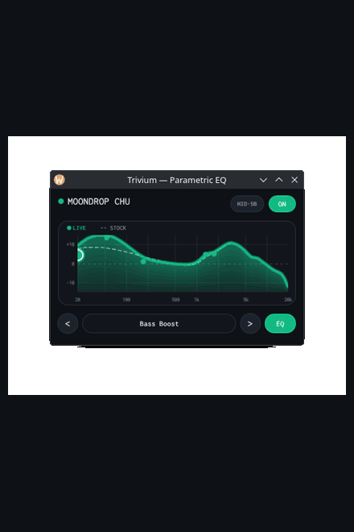
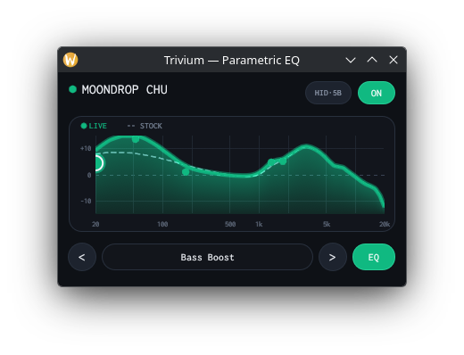
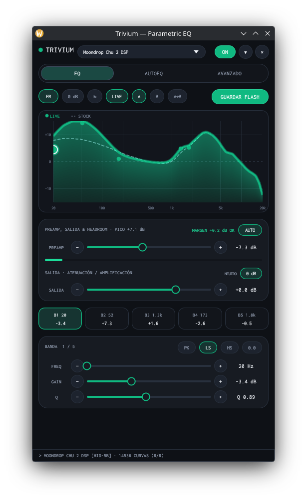

# Trivium — Universal Parametric EQ & AutoEQ Suite

**Language:** **English** · [Español](./README.es.md) · [Auto-translate (other languages)](https://translate.google.com/translate?sl=en&tl=auto&u=https://github.com/Speed17x/Trivium)

> [!NOTE]
> **AI Development Transparency:** This project is designed and developed using artificial intelligence inside **Google Antigravity**, built specifically by **Gemini** across multiple model iterations (**Flash**, **Hydrogen**, **Argon**, **Neon**, and **Carbon**) spanning architecture, DSP protocol porting, UI, and verification, under the direction, design decisions, and real-hardware testing of [@Speed17x](https://github.com/Speed17x).

**Trivium** (`v3.0.0`, formerly *AutoQ*) is a cross-platform parametric equalization (**PEQ**), hardware DSP control, and **AutoEQ** suite written in **Rust** for desktop and **Kotlin + Jetpack Compose** for Android (`com.speed17x.trivium`). It brings three paths together: **9 USB-C DSP Families + BLE GATT** · **System-Wide EQ with Output Gain/Attenuation (`-30.0` to `+12.0 dB`)** · **AutoEQ Catalog (+14,500 curves across 8 sources)**.

---

## Supported Platforms (`v3.0.0`)

| Platform | Status | Deliverables & Key Capabilities |
| :--- | :--- | :--- |
| **Linux (`x86_64` & `aarch64`)** | **Stable** (primary) | Desktop GUI (`trivium`), `trivium-cli`, `trivium-daemon`, PipeWire (`-30..+12 dB`), 9 USB DSP families, Hyprland, KDE Plasma 6 Plasmoid (`org.speed17x.trivium`), `AppImage`, and `.deb`. |
| **Android 9+ (`API 28–36`)** | **Stable** (`com.speed17x.trivium`) | 9 USB Host DSP families, native **BLE GATT** (FiiO EH11/EH13, Airoha/Maxwell), `GlobalEqService` (`-30..+12 dB` post-limiter), themed home widget, and signed APK. |
| **Windows 10/11 (`x64`)** | **Functional Beta** | Single-file **`Trivium-Setup-x64.exe`** installer & portable `.zip` (`Trivium.exe` with zero console flashes, `hidapi`, Equalizer APO with preamp and `-30..+12 dB` output gain). |
| **macOS Apple Silicon (`aarch64`)** | **Experimental** | `Trivium-macOS-arm64.zip` via `hidapi` (`macos-shared-device`), `hid-scan --dump-descriptors`, AutoEQ, and exporters (unsigned, no Apple Developer ID). |

> [!TIP]
> **Using another USB-C DSP DAC or cable?** Run `trivium-cli hid-scan --dump-descriptors --json` and open an *Issue* at [Speed17x/Trivium](https://github.com/Speed17x/Trivium/issues); see per-model status in [`docs/HARDWARE_MATRIX.md`](./docs/HARDWARE_MATRIX.md).

---

## Screenshots (`Default` Emerald · also includes `Default Light` & `NothingOS`)

<p align="center">
  
</p>

| Compact Widget (`Trivium`) | Parametric EQ (`EQ` + Output Gain) | AutoEQ (+14,500 curves) | Advanced & 1-Click |
| :---: | :---: | :---: | :---: |
|  |  |  |  |

---

## Quick Start

Download prebuilt binaries from [GitHub Releases](https://github.com/Speed17x/Trivium/releases) (verify integrity with `sha256sum -c SHA256SUMS.txt`).

- **Android:** install `Trivium-Android.apk` or import [`obtainium-trivium.json`](./packaging/android/obtainium-trivium.json) in Obtainium (build guide & AutoQ v2.x migration note in [`android/README.md`](./android/README.md)).
- **Linux (`AppImage` / `.deb` / One-liner):**
  ```bash
  # Quick SHA256-verified user installer (or pass --cli-only):
  curl -fsSL https://raw.githubusercontent.com/Speed17x/Trivium/main/install-linux.sh | bash
  # Debian / Ubuntu / Mint:
  sudo apt install ./trivium_3.0.0_amd64.deb
  ```
- **Hyprland / KDE Plasma 6:** 1-click install from **Advanced** in the GUI or `./Trivium-x86_64.AppImage --install-hyprland-widget` / `--install-kde-plasmoid`.
- **Windows:** run **`Trivium-Setup-x64.exe`** or **`Trivium-Windows-x64.zip`** ([`windows-beta/README.md`](./windows-beta/README.md)).
  > [!WARNING]
  > **Windows SmartScreen:** `Trivium-Setup-x64.exe` and `Trivium.exe` are currently **unsigned** (pending free open-source Authenticode signing via SignPath Foundation), so Windows Defender SmartScreen will show an *"Unknown publisher"* warning. Verify the file hash against `SHA256SUMS.txt` and click **More info → Run anyway** (or compile from source).
- **macOS (`arm64`):** extract `Trivium-macOS-arm64.zip` and run `xattr -dr com.apple.quarantine ./trivium ./trivium-cli ./trivium-daemon`.
- **Quick CLI:** `trivium-cli eq "Moondrop Chu 2" --target "Harman In-Ear 2019" --apply --commit` · `trivium-cli hid-scan --dump-descriptors` · `trivium-cli ble-protocols`.

**Rootless USB permissions on Linux:** `.deb` and the 1-click installer install [`99-trivium-usb-dsp.rules`](./packaging/udev/99-trivium-usb-dsp.rules) (`MODE="0660", TAG+="uaccess"`). Manual reload: `sudo udevadm control --reload-rules && sudo udevadm trigger`.

---

## Technical Documentation

- [Hardware & Protocol Matrix (USB HID, BLE GATT, System EQ)](./docs/HARDWARE_MATRIX.md)
- [Architecture & Workspace Crates (`crates/*`, exporters, flows)](./docs/ARCHITECTURE.md)
- [Packaging & Distribution (`deb`, `install-linux.sh`, WinGet, Obtainium)](./packaging/README.md)
- [USB HID Protocol](./docs/USB_HID_PROTOCOL.md) · [Android Shared Rust Core Evaluation](./docs/ANDROID_RUST_CORE_EVAL.md)
- [Roadmap](./ROADMAP.md) · [Changelog (`CHANGELOG.md`)](./CHANGELOG.md)

---

## License

Licensed under **GPL-2.0-or-later** ([`LICENSE`](./LICENSE)). Frequency response measurements belong to their respective authors in AutoEq and Squiglink repositories.
