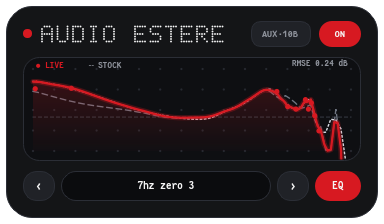

# AutoQ — Universal Parametric EQ & AutoEQ Suite

> [!NOTE]
> **Transparencia de desarrollo (IA):** Este proyecto está diseñado y desarrollado mediante inteligencia artificial dentro de **Google Antigravity**, construido específicamente por **Gemini** a lo largo de sus distintas iteraciones y modelos (**Flash**, **Hydrogen**, **Argon**, **Neon** y **Carbon**) en arquitectura, portado de protocolos DSP, interfaces y verificación, bajo la dirección, decisiones de diseño y pruebas en hardware real de [@Speed17x](https://github.com/Speed17x).

**AutoQ** (`v2.2.0`) es una suite multiplataforma de ecualización paramétrica (**PEQ**) y calibración **AutoEQ** impulsada por un **workspace nativo en Rust** en escritorio (Linux y Windows) y **Kotlin + Jetpack Compose** en Android. Incluye un sistema de **temas modulares** (**`Default`**, **`Default claro`** y **`NothingOS`** opcional), **8 colores de resaltado** seleccionables y tipografía monoespaciada **Consolas / Inconsolata**.

Permite controlar tanto **hardware DSP USB-C integrado multiprotocolo (8 familias)** (*Moondrop*, *FiiO / JadeAudio / SNOWSKY*, *Tanchjim*, *Kiwi Ears*, *CrinEar*, *JCALLY*, *NiceHCK*, *LETSHUOER*, *ddHifi*, *Truthear*, *Qudelix-5K*, *Topping*, *Fosi Audio* y *JDS Labs*) como **cualquier audífono Bluetooth, DAC USB o salida analógica de 3.5 mm** mediante ecualización global del sistema.

---

## Estado actual y madurez por plataforma (`v2.2.0`)

| Plataforma | Estado | Alcance verificado |
| :--- | :--- | :--- |
| **Linux (`x86_64` y `aarch64`)** | **Estable** (principal) | App nativa Rust (`autoq-gui`), CLI (`autoq-cli`), daemon residente (`autoq-daemon`), PipeWire `filter-chain` con preamp `mixer` 10B, USB-C HID/Serial (8 familias), widget Hyprland, Plasmoid KDE Plasma 6 temático, AppImage, `.deb` y `PKGBUILD`. |
| **Android 9+ (`API 28–36`)** | **Estable** | Paridad completa: 8 familias USB Host DSP, `GlobalEqService` con preamp manual/auto y apagado completo, widget de inicio sincronizado con temas, comparación A/B, exportadores multi-formato y **APK `release` firmado de forma permanente** (+ perfil **Obtainium**). |
| **Windows 10/11 (`x64`)** | **Beta funcional** (probado en Windows real) | Funciona en pruebas reales de Windows: instalador único **`AutoQ-Setup-x64.exe`** (Inno Setup) + portable `.zip` 100 % Rust sin ventanas de terminal emergentes (`hidapi`, registro USB-CDC sin PowerShell y **Equalizer APO**). Pendiente firma Authenticode pública (SmartScreen). |

> [!TIP]
> **¿Tienes otro DAC o cable USB-C DSP?** Ejecuta `autoq-cli hid-scan --all` en tu equipo y comparte la salida en un *Issue* para validar o añadir soporte de nuevas familias y *firmwares*.

---

## Capturas

> Muestran el tema opcional **`NothingOS`** (matriz de puntos 5×7 y acento rojo). También puedes elegir los temas limpios **`Default`** y **`Default claro`** más **8 colores de resaltado** en la pestaña *Avanzado*.

| Widget Compacto | Ecualizador Paramétrico (`EQ`) | Motor AutoEQ (+14,500 curvas) | Avanzado & Integración 1-Clic |
| :---: | :---: | :---: | :---: |
|  |  |  |  |

---

## Estructura del monorepo

| Carpeta | Plataforma | Interfaz / Entregable | Motor y capacidades |
| :--- | :--- | :--- | :--- |
| [`crates/autoq-core`](./crates/autoq-core/) | **Núcleo Multiplataforma (Rust)** | Librería compartida | Optimizador RBJ/PEQ (`< 0.5 ms`), **8 familias USB DSP** (`KTMicro`, `Moondrop 8B`, `WalkPlay`, `FiiO`, `Qudelix-5K`, `Topping`, `Fosi DS3`, `JDS Element IV`), AutoEQ 8 fuentes, PipeWire, Equalizer APO, BT SPP y persistencia `ui_settings.json`. |
| [`crates/autoq-gui`](./crates/autoq-gui/) | **GUI de Escritorio (Rust)** | App nativa `eframe`/`egui` (`~9 MB`) | Temas modulares (`Default`, `Default claro`, `NothingOS`), 8 colores de resaltado, consola tipográfica Consolas/Inconsolata, modo widget flotante `--widget` y gestión 1-clic. |
| [`crates/autoq-cli`](./crates/autoq-cli/) | **CLI & Telemetría (Rust)** | Binario independiente (`~2.9 MB`) | Comandos `eq`, `hid-scan --all`, `poll` (`~1 ms`), `waybar-status` y JSON CLI para terminal, Waybar y KDE Plasma 6. |
| [`crates/autoq-daemon`](./crates/autoq-daemon/) | **Daemon Residente (Rust)** | Servicio opcional (`systemd --user` / Windows) | Escucha eventos `udevadm monitor` + `pactl subscribe` para aplicar automáticamente el perfil guardado en `daemon_profiles.json` al conectar tus audífonos o DAC. |
| [`android/`](./android/) | **Android 9+ (API 28–36)** | App Kotlin + Jetpack Compose + Widget | Paridad completa (`v2.2.0`): 8 familias USB DSP, BT SPP, `GlobalEqService`, temas modulares, widget sincronizado, preamp/headroom, comparación A/B, exportadores y APK `release` firmado. |
| [`linux-appimage/`](./linux-appimage/) | **Linux Universal (`AppImage x86_64`)** | AppImage nativo en Rust (`< 10 MB`) | Incluye `autoq-gui`, `autoq-cli`, `autoq-daemon` e instaladores de Hyprland y KDE. |
| [`packaging/`](./packaging/) | **Paquetes Linux & `udev`** | `.deb` (`apt`), `PKGBUILD` (AUR) y `systemd` | Instala binarios nativos, unidad `autoq-daemon.service` y reglas `udev` multiprotocolo en `/lib/udev/rules.d/99-autoq-usb-dsp.rules`. |
| [`linux-kde/`](./linux-kde/) | **Linux / KDE Plasma 6** | Plasmoid nativo QML (`org.hector.moondropeq`) | Alimentado directamente por `autoq-cli` en Rust (`poll` en `~1 ms`). |
| [`linux-hyprland/`](./linux-hyprland/) | **Linux / Hyprland & Waybar** | Atajos `SUPER+E`, `hyprland-autoq.conf` y módulo Waybar | Lanza el widget flotante 100 % Rust (`autoq-gui --widget`) con instancia única por socket Unix (`--toggle`). |
| [`windows-beta/`](./windows-beta/) | **Windows 10/11 (`Beta`)** | Instalador **`AutoQ-Setup-x64.exe`** + Portable `.zip` | `AutoQ.exe` (ícono e info PE nativa, cero consolas) + `autoq-cli.exe` + `autoq-daemon.exe` 100 % Rust (`hidapi`, Registro USB-CDC y Equalizer APO 10B). |
| [`docs/`](./docs/) | **Documentación y Roadmap** | — | [Roadmap](./ROADMAP.md), [Historial (`CHANGELOG.md`)](./CHANGELOG.md), [Arquitectura](./docs/ARCHITECTURE.md) y [Protocolo USB HID](./docs/USB_HID_PROTOCOL.md). |

---

## Características principales

* **Control de Hardware DSP USB-C Multiprotocolo — 8 familias (sin apps propietarias):**
  1. **KTMicro 5 bandas (`VID 0x31B2`)**: *Moondrop Chu 2 DSP / CDSP / Quark 2 / Jiu / May*, *Kiwi Ears Allegro Mini / PRO*, *JCALLY JM12*, *Tanchjim Zero / One / Tanya DSP*.
  2. **Moondrop 8 bandas**: *FreeDSP Pro / Mini*, *Rays*, *AG Rays*, *Marigold*, *DAWN PRO 2*, *Echo A*, *MOONRIVER 3*, *DHA15*.
  3. **WalkPlay (19 VIDs, 5–10 bandas)**: *Tanchjim Bunny DSP / Stargate II / Space Pro*, *CrinEar Protocol Max (10B)*, *NiceHCK*, *LETSHUOER*, *ddHifi*, *Truthear* DSP.
  4. **FiiO / JadeAudio / SNOWSKY (`VID 0x2972`, `0x0A12`, 5–10 bandas)**: *JA11*, *JIEZI*, *KA15*, *KA17*, *BTR13*, *BTR17*, *QX13*, *Q7*, *BT11*, *SNOWSKY Melody / TINY*.
  5. **Qudelix-5K (`VID 0x0A12`, 10 bandas)**: lectura de *bitstream* V3 y escritura HID `SetEqBandParam`.
  6. **Topping DX1 II / E50 II (`VID 0x152A`, 11 bandas L+R)**: tramas HID de 16 bytes con lectura multiframe y CRC-16/MODBUS.
  7. **Fosi Audio DS3 (`VID 0x152A`, 8 bandas)**: HID Feature/Output Reports `0x77` en `float32 LE`.
  8. **JDS Labs Element IV (`152a:88fa`, 12 bandas)**: protocolo USB-CDC Serial JSON (`2 LSQ + 8 PK + 2 HSQ`).
  * **Diagnóstico instantáneo:** `autoq-cli hid-scan --all` muestra el `VID:PID`, protocolo detectado y número de bandas de cualquier dispositivo conectado.
* **Temas Modulares, Color de Resaltado y Widgets Sincronizados:**
  * Elige en la pestaña **Avanzado** (Escritorio y Android) entre **`Default`**, **`Default claro`** y **`NothingOS`** (opcional) + **8 colores de resaltado** (`Tema`, `Azul`, `Rojo`, `Verde`, `Violeta`, `Naranja`, `Cian`, `Rosa`). Tanto el **Widget de Android** como el **Plasmoid KDE Plasma 6** heredan dinámicamente la paleta seleccionada.
* **Control Audiófilo de Preamp, Headroom y Comparación A/B Instantánea:**
  * Medidor visual de margen anti-*clipping* con cálculo automático o ajuste manual de **Preamp** (aplicado a PipeWire `mixer`, Equalizer APO y `GlobalEqService`), más slots de comparación rápida **A / B** en la pestaña **EQ**.
* **Exportación Multi-Formato y Daemon Residente (`autoq-daemon`):**
  * Importa `ParametricEQ.txt` y exporta directamente a **EqualizerAPO**, **EasyEffects (JSON)**, **CamillaDSP (YAML)** y **Wavelet (`GraphicEQ:` 127 bandas)** desde Escritorio, Android o `autoq-cli`.
  * `autoq-daemon` detecta en segundo plano cuando conectas un DAC USB o audífono PipeWire y aplica automáticamente el perfil guardado (`~/.config/autoq/daemon_profiles.json`).
* **Ecualizador Universal a nivel de sistema (10 bandas):**
  * **Linux:** `libpipewire-module-filter-chain` nativo en PipeWire para cualquier salida Bluetooth, USB-C o 3.5 mm.
  * **Android:** `GlobalEqService` (`DynamicsProcessing` 32B/PEQ) con botón de apagado total de ecualización y detención completa del servicio.
  * **Windows (`Beta`):** generación automática de `autoq_eq.txt` con preamp anti-clipping para **Equalizer APO**.
* **Catálogo AutoEQ de +14,500 curvas de 8 fuentes abiertas + Imitación:**
  * Sincroniza **AutoEq (jaakkopasanen/AutoEq)** + 7 bases **Squiglink** (*Super\* Review, ReganCipher, Aftersound, HBB, Paul Wasabii, Jaytiss, GadgetryTech*), incluye 8 targets curados (*Harman In-Ear 2019*, *Harman Over-Ear 2018*, *JM-1*, *Diffuse Field 5128*, *Oratory1990*, etc.) y modo **Imitar cualquier audífono**.
* **Filtros `PK` / `LS` / `HS`, EqualizerAPO y Bluetooth SPP:**
  * Importación/exportación de `ParametricEQ.txt` y control Bluetooth Classic SPP (`POP`, `MON`, `BASS`) en modelos Moondrop compatibles.

---

## Inicio rápido por plataforma

Descarga los binarios precompilados desde [GitHub Releases](https://github.com/Speed17x/AutoQ/releases) (se recomienda verificar la integridad con `sha256sum -c SHA256SUMS.txt`).

### 1. Android (`AutoQ-Android.apk`)
* **Descarga directa:** instala [`AutoQ-Android.apk`](https://github.com/Speed17x/AutoQ/releases/latest) desde Releases.
  > **Nota de actualización:** A partir de `v2.1.2`, el APK se compila en modo `release` con clave de firma fija. Si tienes instalada una versión `debug` anterior (`v2.1.1` o previa), desinstálala una única vez antes de instalar `v2.1.2`; todas las versiones futuras se actualizarán directamente encima sin borrar tus presets.
* **Compilación local (`android/`, ver [`android/README.md`](./android/README.md)):**
  ```bash
  cd android
  ./gradlew testDebugUnitTest assembleDebug
  ```

### 2. Linux (`AppImage`, `.deb`, `makepkg` o `install-linux.sh`)
* **AppImage universal (`AutoQ-x86_64.AppImage`):**
  ```bash
  chmod +x AutoQ-x86_64.AppImage
  ./AutoQ-x86_64.AppImage                        # Abre la app completa 100 % Rust
  ./AutoQ-x86_64.AppImage --install-hyprland-widget   # (Opcional) Widget Hyprland
  ./AutoQ-x86_64.AppImage --install-kde-plasmoid      # (Opcional) Plasmoid KDE Plasma 6
  ```
* **Debian / Ubuntu / Linux Mint / Pop!_OS (`apt`):**
  ```bash
  sudo apt install ./autoq_2.2.0_amd64.deb
  ```
* **Arch Linux / CachyOS / EndeavourOS (`makepkg`):**
  ```bash
  cd packaging/aur && makepkg -si
  ```
  *(La publicación remota en AUR como `paru -S autoq-bin` está en espera de reapertura de registro en `aur.archlinux.org`.)*
* **Instalador rápido de usuario (o solo CLI):**
  ```bash
  # Revisa el script antes de ejecutarlo si lo prefieres: https://github.com/Speed17x/AutoQ/blob/main/install-linux.sh
  curl -fsSL https://raw.githubusercontent.com/Speed17x/AutoQ/main/install-linux.sh | bash
  # Solo CLI ultraligero (~2.9 MB):
  curl -fsSL https://raw.githubusercontent.com/Speed17x/AutoQ/main/install-linux.sh | bash -s -- --cli-only
  ```
* **Uso desde terminal con `autoq-cli`:**
  ```bash
  autoq-cli hid-scan --all
  autoq-cli eq "Moondrop Chu 2" --target "Harman In-Ear 2019" --commit
  autoq-cli eq "Moondrop Chu 2" --match "7Hz x Crinacle Zero 3" --out ParametricEQ.txt
  ```

### 3. Linux — Hyprland & KDE Plasma 6 (Nativo en Rust)
Los widgets de escritorio ya viajan integrados dentro del `.AppImage` y `.deb` (instalables en **1 clic** desde la pestaña **AVANZADO**). Para compilar/instalar desde fuente:
* **Hyprland (`pipewire` + `wireplumber`):**
  ```bash
  cd linux-hyprland && chmod +x install.sh && ./install.sh
  ```
  Agrega `source = ~/.local/share/autoq-hyprland/hyprland-autoq.conf` a tu `~/.config/hypr/hyprland.conf` y presiona **`SUPER + E`**.
* **KDE Plasma 6:**
  ```bash
  cd linux-kde && kpackagetool6 --type Plasma/Applet --install plasmoid
  ```

### 4. Windows 10/11 (`AutoQ-Setup-x64.exe` + Portable)
> [!NOTE]
> **Probado funcionalmente en Windows 10/11.** Al ser software libre aún sin certificado Authenticode comercial (en camino vía SignPath Foundation), Windows SmartScreen puede pedir confirmación (*Más información → Ejecutar de todas formas*) la primera vez. Consulta [`windows-beta/README.md`](./windows-beta/README.md).

Descarga **`AutoQ-Setup-x64.exe`** (instalador único recomendado) o **`AutoQ-Windows-x64.zip`** desde Releases, o compila localmente con Rust (`x86_64-pc-windows-msvc`):
```powershell
cd windows-beta
.\build_windows.ps1
```

---

## Permisos USB HID / Serial en Linux (sin `sudo`)

Tanto el paquete `.deb` como el instalador integrado en la pestaña **Avanzado** configuran las reglas de acceso automáticamente. Si deseas aplicarlas de forma manual con **mínimo privilegio** (solo al usuario activo de la sesión local mediante `systemd-logind`, en lugar de `0666` global), copia [`packaging/udev/99-autoq-usb-dsp.rules`](./packaging/udev/99-autoq-usb-dsp.rules) o crea `/etc/udev/rules.d/99-autoq-usb-dsp.rules` con `MODE="0660", TAG+="uaccess"`:

```udev
# KTMicro (Moondrop Chu 2/May/Quark 2, Kiwi Ears Allegro, JCALLY, Tanchjim)
SUBSYSTEM=="hidraw", ATTRS{idVendor}=="31b2", MODE="0660", TAG+="uaccess"
# Moondrop 8-band & WalkPlay (FreeDSP, Rays, DAWN PRO 2, Tanchjim Bunny, CrinEar Protocol Max, etc.)
SUBSYSTEM=="hidraw", ATTRS{idVendor}=="2fc6", MODE="0660", TAG+="uaccess"
SUBSYSTEM=="hidraw", ATTRS{idVendor}=="2f20", MODE="0660", TAG+="uaccess"
SUBSYSTEM=="hidraw", ATTRS{idVendor}=="3302", MODE="0660", TAG+="uaccess"
# FiiO / JadeAudio / SNOWSKY / Qudelix-5K
SUBSYSTEM=="hidraw", ATTRS{idVendor}=="2972", MODE="0660", TAG+="uaccess"
SUBSYSTEM=="hidraw", ATTRS{idVendor}=="0a12", MODE="0660", TAG+="uaccess"
# Fosi Audio DS3 / Topping DX1 II & E50 II
SUBSYSTEM=="hidraw", ATTRS{idVendor}=="152a", MODE="0660", TAG+="uaccess"
# JDS Labs Element IV (USB-CDC Serial)
SUBSYSTEM=="tty", ATTRS{idVendor}=="152a", ATTRS{idProduct}=="88fa", MODE="0660", TAG+="uaccess"
```

*(La lista completa de 19 VIDs de WalkPlay se encuentra en [`packaging/udev/99-autoq-usb-dsp.rules`](./packaging/udev/99-autoq-usb-dsp.rules)).* Recarga después con:
```bash
sudo udevadm control --reload-rules && sudo udevadm trigger
```

---

## Documentación técnica

* [Roadmap del proyecto (Fases 4–6)](./ROADMAP.md)
* [Historial de versiones (`CHANGELOG.md`)](./CHANGELOG.md)
* [Arquitectura general y flujo de datos](./docs/ARCHITECTURE.md)
* [Evaluación de núcleo compartido Android (`autoq-core` JNI / UniFFI)](./docs/ANDROID_RUST_CORE_EVAL.md)
* [Especificación del protocolo USB HID](./docs/USB_HID_PROTOCOL.md)
* [Guía de WinGet + SignPath para Windows](./packaging/winget/README.md) y [Perfil Obtainium Android](./packaging/android/obtainium-autoq.json)

---

## Licencia

Distribuido bajo licencia **GPL-2.0-or-later** (ver [`LICENSE`](./LICENSE)). Las mediciones de respuesta en frecuencia pertenecen a sus respectivos autores en AutoEq y las bases comunitarias de Squiglink.
