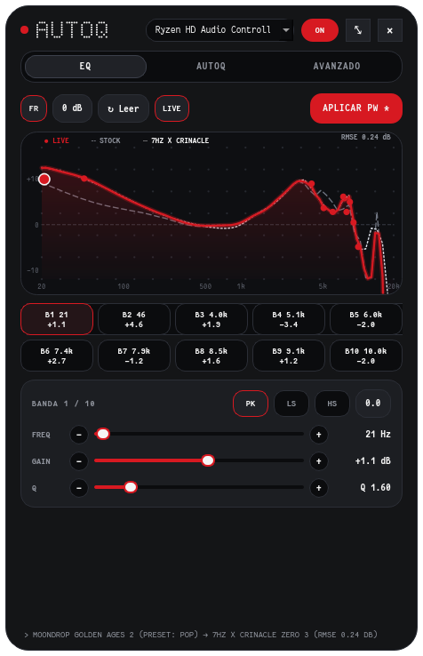

# Trivium — Universal Parametric EQ & AutoEQ Suite

> [!NOTE]
> **Transparencia de desarrollo (IA):** Este proyecto está diseñado y desarrollado mediante inteligencia artificial dentro de **Google Antigravity**, construido específicamente por **Gemini** a lo largo de sus distintas iteraciones y modelos (**Flash**, **Hydrogen**, **Argon**, **Neon** y **Carbon**) en arquitectura, portado de protocolos DSP, interfaces y verificación, bajo la dirección, decisiones de diseño y pruebas en hardware real de [@Speed17x](https://github.com/Speed17x).

**Trivium** (`v3.0.0`, anteriormente *AutoQ*) es una suite multiplataforma de ecualización paramétrica (**PEQ**), control de hardware DSP y calibración **AutoEQ** escrita en **Rust** para escritorio y **Kotlin + Jetpack Compose** para Android (`com.speed17x.trivium`). Converge en tres frentes: **9 familias USB-C DSP + BLE GATT** · **EQ Global del Sistema con atenuación/ganancia de salida (`-30.0` a `+12.0 dB`)** · **Catálogo AutoEQ (+14,500 curvas de 8 fuentes)**.

---

## Plataformas soportadas (`v3.0.0`)

| Plataforma | Estado | Entregables y capacidades clave |
| :--- | :--- | :--- |
| **Linux (`x86_64` y `aarch64`)** | **Estable** (principal) | App GUI (`trivium`), `trivium-cli`, `trivium-daemon`, PipeWire (`-30..+12 dB`), 9 familias USB DSP, Hyprland, Plasmoid KDE Plasma 6 (`org.speed17x.trivium`), `AppImage` y `.deb`. |
| **Android 9+ (`API 28–36`)** | **Estable** (`com.speed17x.trivium`) | 9 familias USB Host DSP, **BLE GATT** nativo (FiiO EH11/EH13, Airoha/Maxwell), `GlobalEqService` (`-30..+12 dB` post-limiter), widget sincronizado y APK firmado. |
| **Windows 10/11 (`x64`)** | **Beta funcional** | Instalador **`Trivium-Setup-x64.exe`** y portable `.zip` (`Trivium.exe` sin ventanas de consola, `hidapi`, Equalizer APO con preamp y salida `-30..+12 dB`). |
| **macOS Apple Silicon (`aarch64`)** | **Experimental** | `Trivium-macOS-arm64.zip` vía `hidapi` (`macos-shared-device`), `hid-scan --dump-descriptors`, AutoEQ y exportadores (sin firma Apple Developer). |

> [!TIP]
> **¿Usas otro DAC o cable USB-C DSP?** Ejecuta `trivium-cli hid-scan --dump-descriptors --json` y abre un *Issue* en [Speed17x/Trivium](https://github.com/Speed17x/Trivium/issues); consulta la compatibilidad detallada por modelo en [`docs/HARDWARE_MATRIX.md`](./docs/HARDWARE_MATRIX.md).

---

## Capturas (`NothingOS` · también incluye `Default` y `Default claro`)

| Widget Compacto | Ecualizador (`EQ`) | AutoEQ (+14,500 curvas) | Avanzado & 1-Clic |
| :---: | :---: | :---: | :---: |
|  |  |  |  |

---

## Inicio rápido

Descarga los artefactos desde [GitHub Releases](https://github.com/Speed17x/Trivium/releases) (verifica con `sha256sum -c SHA256SUMS.txt`).

- **Android:** instala `Trivium-Android.apk` o importa [`obtainium-trivium.json`](./packaging/android/obtainium-trivium.json) en Obtainium (guía de compilación y migración desde AutoQ v2.x en [`android/README.md`](./android/README.md)).
- **Linux (`AppImage` / `.deb` / Script):**
  ```bash
  # Instalador rápido verificando SHA256 (o --cli-only):
  curl -fsSL https://raw.githubusercontent.com/Speed17x/Trivium/main/install-linux.sh | bash
  # Debian / Ubuntu / Mint:
  sudo apt install ./trivium_3.0.0_amd64.deb
  ```
- **Hyprland / KDE Plasma 6:** instala en 1 clic desde **Avanzado** en la App GUI o con `./Trivium-x86_64.AppImage --install-hyprland-widget` / `--install-kde-plasmoid`.
- **Windows:** ejecuta **`Trivium-Setup-x64.exe`** o **`Trivium-Windows-x64.zip`** ([`windows-beta/README.md`](./windows-beta/README.md)).
- **macOS (`arm64`):** descomprime `Trivium-macOS-arm64.zip` y ejecuta `xattr -dr com.apple.quarantine ./trivium ./trivium-cli ./trivium-daemon`.
- **CLI rápido:** `trivium-cli eq "Moondrop Chu 2" --target "Harman In-Ear 2019" --apply --commit` · `trivium-cli hid-scan --dump-descriptors` · `trivium-cli ble-protocols`.

**Permisos USB sin `sudo` en Linux:** `.deb` y el instalador 1-clic copian [`99-trivium-usb-dsp.rules`](./packaging/udev/99-trivium-usb-dsp.rules) (`MODE="0660", TAG+="uaccess"`). Recarga manual: `sudo udevadm control --reload-rules && sudo udevadm trigger`.

---

## Documentación técnica

- [Matriz de Hardware y Protocolos (USB HID, BLE GATT, System EQ)](./docs/HARDWARE_MATRIX.md)
- [Arquitectura y módulos (`crates/*`, exportadores, flujos)](./docs/ARCHITECTURE.md)
- [Empaquetado y distribución (`deb`, `install-linux.sh`, WinGet, Obtainium)](./packaging/README.md)
- [Protocolo USB HID](./docs/USB_HID_PROTOCOL.md) · [Evaluación Rust/Android](./docs/ANDROID_RUST_CORE_EVAL.md)
- [Roadmap](./ROADMAP.md) · [Historial (`CHANGELOG.md`)](./CHANGELOG.md)

---

## Licencia

Distribuido bajo licencia **GPL-2.0-or-later** ([`LICENSE`](./LICENSE)). Las curvas de respuesta pertenecen a sus autores en AutoEq y Squiglink.
