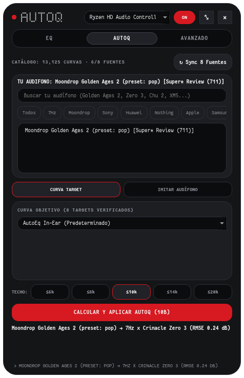

# Trivium — Universal Parametric EQ & AutoEQ Suite

> [!NOTE]
> **Transparencia de desarrollo (IA):** Este proyecto está diseñado y desarrollado mediante inteligencia artificial dentro de **Google Antigravity**, construido específicamente por **Gemini** a lo largo de sus distintas iteraciones y modelos (**Flash**, **Hydrogen**, **Argon**, **Neon** y **Carbon**) en arquitectura, portado de protocolos DSP, interfaces y verificación, bajo la dirección, decisiones de diseño y pruebas en hardware real de [@Speed17x](https://github.com/Speed17x).

**Trivium** (`v3.0.0`, anteriormente *AutoQ*) es una suite multiplataforma de ecualización paramétrica (**PEQ**), control de hardware DSP y calibración **AutoEQ** impulsada por un **workspace nativo en Rust** en escritorio (Linux, Windows y macOS experimental) y **Kotlin + Jetpack Compose** en Android (`com.speed17x.trivium`).

Su nombre hace referencia al punto donde convergen tres caminos: **Hardware DSP Directo · EQ Global del Sistema · Base AutoEQ**, con estética modular (**`Default`**, **`Default claro`** y **`NothingOS`** opcional), **8 colores de resaltado** y tipografía monoespaciada **Consolas / Inconsolata**.

Permite controlar tanto **9 familias de hardware DSP USB-C integrado** (*Moondrop*, *FiiO / JadeAudio / SNOWSKY*, *Tanchjim*, *Kiwi Ears*, *CrinEar*, *JCALLY*, *NiceHCK*, *LETSHUOER*, *ddHifi*, *Truthear*, *Qudelix-5K*, *Topping*, *Fosi Audio* y *JDS Labs*) como **transporte inalámbrico BLE GATT** (*FiiO EH11/EH13*, *Airoha / Audeze Maxwell*) y **cualquier audífono Bluetooth, DAC USB o salida analógica de 3.5 mm** mediante ecualización global del sistema con **atenuación / amplificación de salida (`-30.0` a `+12.0 dB`)**.

---

## Estado actual y madurez por plataforma (`v3.0.0`)

| Plataforma | Estado | Alcance verificado |
| :--- | :--- | :--- |
| **Linux (`x86_64` y `aarch64`)** | **Estable** (principal) | App nativa Rust (`trivium`), CLI (`trivium-cli`), daemon residente (`trivium-daemon`), PipeWire `filter-chain` con Preamp y Salida `-30..+12 dB`, 9 familias USB-C HID/Serial, codecs BLE GATT, `hid-scan --dump-descriptors`, Hyprland, Plasmoid KDE Plasma 6 (`org.speed17x.trivium`), AppImage, `.deb` y `PKGBUILD`. |
| **Android 9+ (`API 28–36`)** | **Estable** (`com.speed17x.trivium`) | 9 familias USB Host DSP (incluyendo Conexant FreeDSP / ECHO-B), transporte inalámbrico nativo **BLE GATT** (FiiO EH11/EH13, Airoha/Maxwell), `GlobalEqService` con Preamp + **Atenuación/Amplificación de Salida (`-30..+12 dB` post-limiter)**, widget sincronizado, comparación A/B, exportadores multi-formato y APK firmado (+ **Obtainium**). |
| **Windows 10/11 (`x64`)** | **Beta funcional** (probado en Windows real) | Instalador único **`Trivium-Setup-x64.exe`** (Inno Setup) + portable `.zip` (`Trivium.exe` sin ventanas de consola emergentes, `hidapi`, registro USB-CDC sin PowerShell, 9 familias DSP y **Equalizer APO** con preamp y salida `-30..+12 dB`). |
| **macOS Apple Silicon (`aarch64`)** | **Experimental** | Compilación nativa `aarch64-apple-darwin` vía `hidapi` (`macos-shared-device`) en CI (`Trivium-macOS-arm64.zip`) para DACs USB-C DSP, `hid-scan --dump-descriptors` y exportación multi-formato (sin firma Apple Developer). |

> [!TIP]
> **¿Tienes otro DAC o cable USB-C DSP?** Ejecuta `trivium-cli hid-scan --dump-descriptors --json` y abre un *Issue* con el resultado; consulta [`docs/HARDWARE_MATRIX.md`](./docs/HARDWARE_MATRIX.md) para ver el estado por modelo y firmware.

---

## Capturas

> Muestran el tema opcional **`NothingOS`** (matriz de puntos 5×7 y acento rojo). También puedes elegir los temas limpios **`Default`** y **`Default claro`** más **8 colores de resaltado** en la pestaña *Avanzado*.

| Widget Compacto | Ecualizador Paramétrico (`EQ`) | Motor AutoEQ (+14,500 curvas) | Avanzado & Integración 1-Clic |
| :---: | :---: | :---: | :---: |
|  |  |  |  |

---

## Estructura del monorepo

| Carpeta | Plataforma | Interfaz / Entregable | Motor y capacidades |
| :--- | :--- | :--- | :--- |
| [`crates/trivium-core`](./crates/trivium-core/) | **Núcleo Multiplataforma (Rust)** | Librería compartida | Optimizador RBJ/PEQ (`< 0.5 ms`), **9 familias USB DSP** (`KTMicro`, `Moondrop 8B`, `Conexant 9B`, `WalkPlay`, `FiiO`, `Qudelix-5K`, `Topping`, `Fosi DS3`, `JDS Element IV`), codecs **BLE GATT**, AutoEQ 8 fuentes, PipeWire, Equalizer APO, BT SPP y migración automática `~/.config/autoq` → `~/.config/trivium`. |
| [`crates/trivium-gui`](./crates/trivium-gui/) | **GUI de Escritorio (Rust)** | Binario `trivium` (`eframe`/`egui`) | Temas modulares (`Default`, `Default claro`, `NothingOS`), 8 colores de resaltado, Consolas/Inconsolata, preamp, ganancia/atenuación de salida `-30..+12 dB`, comparación A/B y modo widget flotante `--widget`. |
| [`crates/trivium-cli`](./crates/trivium-cli/) | **CLI & Telemetría (Rust)** | Binario `trivium-cli` | Comandos `eq`, `hid-scan --dump-descriptors`, `ble-protocols`, `poll`, `waybar-status` y JSON CLI. |
| [`crates/trivium-daemon`](./crates/trivium-daemon/) | **Daemon Residente (Rust)** | Binario `trivium-daemon` | Escucha eventos `udevadm monitor` + `pactl subscribe` para aplicar automáticamente perfiles guardados en `daemon_profiles.json`. |
| [`android/`](./android/) | **Android 9+ (`com.speed17x.trivium`)** | App Kotlin + Jetpack Compose + Widget | 9 familias USB DSP, transporte **BLE GATT** nativo, `GlobalEqService` con Preamp y **Salida `-30..+12 dB`**, temas modulares, widget sincronizado, comparación A/B, exportadores y APK firmado. |
| [`linux-appimage/`](./linux-appimage/) | **Linux Universal (`AppImage x86_64`)** | `Trivium-x86_64.AppImage` | Incluye `trivium`, `trivium-cli`, `trivium-daemon` e instaladores de Hyprland y KDE. |
| [`packaging/`](./packaging/) | **Paquetes & `udev`** | `.deb`, `PKGBUILD` (AUR), WinGet, Obtainium | Reglas `udev` (`99-trivium-usb-dsp.rules` con `0660+uaccess`) y unidad `trivium-daemon.service`. |
| [`linux-kde/`](./linux-kde/) | **Linux / KDE Plasma 6** | Plasmoid QML (`org.speed17x.trivium`) | Alimentado directamente por `trivium-cli` en Rust. |
| [`linux-hyprland/`](./linux-hyprland/) | **Linux / Hyprland & Waybar** | Atajos `SUPER+E`, `hyprland-trivium.conf` | Lanza el widget flotante (`trivium --widget`) con instancia única por socket Unix (`--toggle`). |
| [`windows-beta/`](./windows-beta/) | **Windows 10/11 (`Beta`)** | `Trivium-Setup-x64.exe` + Portable `.zip` | `Trivium.exe` (ícono e info PE nativa) + `trivium-cli.exe` + `trivium-daemon.exe` con Equalizer APO. |
| [`docs/`](./docs/) | **Documentación y Roadmap** | — | [Matriz de Hardware](./docs/HARDWARE_MATRIX.md), [Roadmap](./ROADMAP.md), [CHANGELOG](./CHANGELOG.md), [Arquitectura](./docs/ARCHITECTURE.md) y [Protocolo USB HID](./docs/USB_HID_PROTOCOL.md). |

---

## Características principales

* **Control de Hardware DSP USB-C Multiprotocolo — 9 familias + BLE GATT (ver [`docs/HARDWARE_MATRIX.md`](./docs/HARDWARE_MATRIX.md)):**
  1. **KTMicro 5 bandas (`VID 0x31B2`)**: *Moondrop Chu 2 DSP / CDSP / Quark 2 / Jiu / May*, *Kiwi Ears Allegro Mini / PRO*, *JCALLY JM12*, *Tanchjim Zero / One / Tanya DSP*.
  2. **Moondrop 8 bandas**: *FreeDSP Pro / Mini*, *Rays*, *AG Rays*, *Marigold*, *DAWN PRO 2*, *Echo A*, *MOONRIVER 3*, *DHA15*.
  3. **Conexant Freeman 9 bandas (`VID 0x35D8`)**: *Moondrop FreeDSP* (`0x1496`) y *Moondrop ECHO-B* (`0x149B`) con coeficientes RBJ para 44.1 / 48 / 96 / 192 kHz.
  4. **WalkPlay (19 VIDs, 5–10 bandas)**: *Tanchjim Bunny DSP / Stargate II / Space Pro*, *CrinEar Protocol Max (10B)*, *NiceHCK*, *LETSHUOER*, *ddHifi*, *Truthear* DSP.
  5. **FiiO / JadeAudio / SNOWSKY (`VID 0x2972`, `0x0A12`, 5–10 bandas)**: *JA11*, *JIEZI*, *KA15*, *KA17*, *BTR13*, *BTR17*, *QX13*, *Q7*, *BT11*, *SNOWSKY Melody / TINY*.
  6. **Qudelix-5K (`VID 0x0A12`, 10 bandas)**: lectura de *bitstream* V3 y escritura HID `SetEqBandParam`.
  7. **Topping DX1 II / E50 II (`VID 0x152A`, 11 bandas L+R)**: tramas HID de 16 bytes con lectura multiframe y CRC-16/MODBUS.
  8. **Fosi Audio DS3 / ZH3 / K7 (`VID 0x152A`, 8 bandas)**: HID Feature/Output Reports `0x77` en `float32 LE`.
  9. **JDS Labs Element IV (`152a:88fa`, 12 bandas)**: protocolo USB-CDC Serial JSON (`2 LSQ + 8 PK + 2 HSQ`).
  10. **BLE GATT inalámbrico (Android + codecs Desktop)**: *FiiO EH11 / EH13* (10B ±20 dB) y *Airoha / Audeze Maxwell* (10B).
  * **Diagnóstico comunitario:** `trivium-cli hid-scan --dump-descriptors --json` extrae `VID:PID`, `UsagePage` y el descriptor HID completo sin abrir el dispositivo.
* **Ganancia / Atenuación de Salida (`-30.0` a `+12.0 dB`) + Preamp & Headroom:**
  * Independiente del **Preamp** anti-*clipping* (`AUTO`/`MANUAL`), **Trivium** incorpora un ajuste dedicado de **Ganancia de Salida (`-30.0` a `+12.0 dB`)** que permite atenuar suavemente el volumen en audífonos/IEMs muy sensibles (aplicado tras el limitador en Android `DynamicsProcessing.Limiter.postGain`, en PipeWire `eq_output_gain` y en Equalizer APO) o ganar hasta `+12 dB` de margen.
* **Temas Modulares, Color de Resaltado y Widgets Sincronizados:**
  * **`Default`**, **`Default claro`** y **`NothingOS`** + **8 colores de resaltado**, heredados dinámicamente por el Widget de Android y el Plasmoid de KDE Plasma 6.
* **Comparación A/B Instantánea, Exportación Multi-Formato y Daemon (`trivium-daemon`):**
  * Slots **A / B** (con curva, preamp y ganancia de salida), exportadores **EqualizerAPO**, **EasyEffects (JSON)**, **CamillaDSP (YAML)** y **Wavelet (`GraphicEQ:` 127B)**, y perfiles automáticos en `~/.config/trivium/daemon_profiles.json`.
* **Catálogo AutoEQ de +14,500 curvas de 8 fuentes abiertas + Imitación:**
  * **AutoEq** + 7 bases **Squiglink**, 8 targets curados y modo **Imitar cualquier audífono**.

---

## Inicio rápido por plataforma

Descarga los binarios precompilados desde [GitHub Releases](https://github.com/Speed17x/Trivium/releases) (verifica la integridad con `sha256sum -c SHA256SUMS.txt`).

### 1. Android (`Trivium-Android.apk` — `com.speed17x.trivium`)
* **Descarga directa:** instala [`Trivium-Android.apk`](https://github.com/Speed17x/Trivium/releases/latest) desde Releases (o usa el perfil [`obtainium-trivium.json`](./packaging/android/obtainium-trivium.json)).
  > Al pasar de *AutoQ* a **Trivium (`v3.0.0`)**, el identificador Android cambia limpiamente a `com.speed17x.trivium` para convivir o sustituir por separado sin conflictos de paquete.
* **Compilación local (`android/`, ver [`android/README.md`](./android/README.md)):**
  ```bash
  cd android
  ./gradlew testDebugUnitTest assembleDebug
  ```

### 2. Linux (`AppImage`, `.deb`, `makepkg` o `install-linux.sh`)
* **AppImage universal (`Trivium-x86_64.AppImage`):**
  ```bash
  chmod +x Trivium-x86_64.AppImage
  ./Trivium-x86_64.AppImage
  ./Trivium-x86_64.AppImage --install-hyprland-widget
  ./Trivium-x86_64.AppImage --install-kde-plasmoid
  ```
* **Debian / Ubuntu / Linux Mint / Pop!_OS (`apt`):**
  ```bash
  sudo apt install ./trivium_3.0.0_amd64.deb
  ```
* **Arch Linux / CachyOS / EndeavourOS (`makepkg`):**
  ```bash
  cd packaging/aur && makepkg -si
  ```
* **Instalador rápido de usuario (o solo CLI):**
  ```bash
  curl -fsSL https://raw.githubusercontent.com/Speed17x/Trivium/main/install-linux.sh | bash
  curl -fsSL https://raw.githubusercontent.com/Speed17x/Trivium/main/install-linux.sh | bash -s -- --cli-only
  ```
* **Uso desde terminal con `trivium-cli`:**
  ```bash
  trivium-cli hid-scan --dump-descriptors
  trivium-cli ble-protocols
  trivium-cli eq "Moondrop Chu 2" --target "Harman In-Ear 2019" --commit
  trivium-cli eq "Moondrop Chu 2" --match "7Hz x Crinacle Zero 3" --out ParametricEQ.txt
  ```

### 3. Linux — Hyprland & KDE Plasma 6
Los widgets de escritorio viajan integrados dentro del `.AppImage` y `.deb` (instalables en **1 clic** desde **AVANZADO**). Desde fuente:
* **Hyprland (`pipewire` + `wireplumber`):**
  ```bash
  cd linux-hyprland && chmod +x install.sh && ./install.sh
  ```
  Agrega `source = ~/.local/share/trivium-hyprland/hyprland-trivium.conf` a `~/.config/hypr/hyprland.conf` y presiona **`SUPER + E`**.
* **KDE Plasma 6:**
  ```bash
  cd linux-kde && kpackagetool6 --type Plasma/Applet --install plasmoid
  ```

### 4. Windows 10/11 (`Trivium-Setup-x64.exe` + Portable) y macOS ARM64 (Experimental)
* **Windows:** descarga **`Trivium-Setup-x64.exe`** o **`Trivium-Windows-x64.zip`** desde Releases (ver [`windows-beta/README.md`](./windows-beta/README.md)).
* **macOS Apple Silicon (Experimental):** descarga **`Trivium-macOS-arm64.zip`** desde Releases; si Gatekeeper bloquea los binarios sin firma Apple Developer, ejecuta `xattr -dr com.apple.quarantine ./trivium ./trivium-cli ./trivium-daemon`.

---

## Permisos USB HID / Serial en Linux (sin `sudo`)

Tanto `.deb` como el botón en **Avanzado** instalan [`packaging/udev/99-trivium-usb-dsp.rules`](./packaging/udev/99-trivium-usb-dsp.rules) en `/etc/udev/rules.d/99-trivium-usb-dsp.rules` usando **`MODE="0660", TAG+="uaccess"`** para todas las familias soportadas (KTMicro, Moondrop 8B, Conexant, WalkPlay, FiiO, Qudelix-5K, Topping, Fosi DS3 y JDS Labs Element IV). Recarga manual:
```bash
sudo udevadm control --reload-rules && sudo udevadm trigger
```

---

## Documentación técnica

* [Matriz de Hardware y Protocolos](./docs/HARDWARE_MATRIX.md)
* [Roadmap del proyecto](./ROADMAP.md)
* [Historial de versiones (`CHANGELOG.md`)](./CHANGELOG.md)
* [Arquitectura general y flujo de datos](./docs/ARCHITECTURE.md)
* [Evaluación de núcleo compartido Android](./docs/ANDROID_RUST_CORE_EVAL.md)
* [Especificación del protocolo USB HID](./docs/USB_HID_PROTOCOL.md)
* [Guía de WinGet + SignPath](./packaging/winget/README.md) y [Perfil Obtainium Android](./packaging/android/obtainium-trivium.json)

---

## Licencia

Distribuido bajo licencia **GPL-2.0-or-later** (ver [`LICENSE`](./LICENSE)). Las mediciones de respuesta en frecuencia pertenecen a sus respectivos autores en AutoEq y las bases comunitarias de Squiglink.
