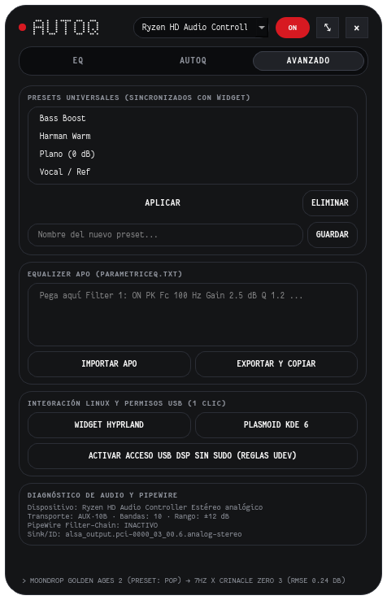

# AutoQ — Universal Parametric EQ & AutoEQ Suite

**AutoQ** es una suite multiplataforma de ecualización paramétrica (PEQ) y calibración **AutoEQ** con estética inspirada en **Nothing OS** (obsidiana mate, matriz de puntos 5×7 y acento `#D71921`), impulsada por una **aplicación y motor 100 % nativos en Rust** en escritorio (Linux y Windows, sin Python) y **Kotlin + Jetpack Compose** en Android.

Permite controlar tanto **hardware DSP USB-C integrado multiprotocolo** (*Moondrop*, *FiiO / JadeAudio / SNOWSKY*, *Tanchjim*, *Kiwi Ears*, *CrinEar*, *JCALLY*, *NiceHCK*, *Truthear*, *WalkPlay*) como **cualquier audífono Bluetooth, DAC USB o salida analógica de 3.5 mm** mediante ecualización global del sistema.

---

## Capturas (Estética Nothing OS)

| Widget Compacto | Ecualizador Paramétrico (`EQ`) | Motor AutoEQ (+14,500 curvas) | Avanzado & Integración 1-Clic |
| :---: | :---: | :---: | :---: |
|  |  |  |  |

---

## Estructura del monorepo

| Carpeta | Plataforma | Interfaz | Motor de EQ |
| :--- | :--- | :--- | :--- |
| [`crates/autoq-core`](./crates/autoq-core/) | **Núcleo Multiplataforma (Rust)** | Librería compartida sin dependencias Python | Optimizador RBJ/PEQ (`< 0.5 ms`), USB-C HID multiprotocolo (**KTMicro 5B**, **Moondrop 8B**, **WalkPlay**, **FiiO 5/10B**), AutoEQ 8 fuentes, PipeWire, Equalizer APO y BT SPP |
| [`crates/autoq-gui`](./crates/autoq-gui/) | **GUI de Escritorio 100 % Rust** | App nativa Nothing OS (`eframe`/`egui`) + widget flotante + instaladores 1-clic (`~9 MB`, cero Python) | Llamadas directas en memoria a `autoq-core` a 60/120 FPS |
| [`crates/autoq-cli`](./crates/autoq-cli/) | **CLI & Telemetría (Rust)** | Binario independiente (`2.9 MB`): `eq`, `hid-scan`, `poll` (`1 ms`), `waybar-status`, JSON CLI | Mismo motor `autoq-core` para terminal, Waybar y KDE Plasma 6 |
| [`android/`](./android/) | **Android 9+ (API 28–36)** | App nativa Jetpack Compose + Widget de pantalla de inicio estilo Nothing OS | USB-C HID (5/8 bandas), Bluetooth SPP y servicio global `GlobalEqService` |
| [`linux-appimage/`](./linux-appimage/) | **Linux Universal (AppImage x86_64)** | AppImage 100 % Rust (`< 10 MB`) + instaladores 1-clic de Hyprland, KDE y `udev` | `autoq-gui` + `autoq-cli` embebidos (cero Python/PySide6) |
| [`packaging/`](./packaging/) | **Gestores de Paquetes Linux** | `.deb` (`apt`), `PKGBUILD` (`paru`/`pacman`) y reglas `udev` multiprotocolo automáticas | Instalación nativa en `/usr/bin/autoq` y `/usr/bin/autoq-cli` |
| [`linux-kde/`](./linux-kde/) | **Linux / KDE Plasma 6** | Plasmoid nativo QML (`org.hector.moondropeq`) | Alimentado directamente por `autoq-cli` en Rust (`poll` en `1 ms`) |
| [`windows-beta/`](./windows-beta/) | **Windows 10/11 (`BETA`)** | Ejecutable portable `AutoQ.exe` + `autoq-cli.exe` 100 % Rust | USB-C HID multiprotocolo (`hidapi`) + EQ global 10 bandas vía **Equalizer APO** |
| [`docs/`](./docs/) | **Documentación y Roadmap** | — | [Roadmap](./ROADMAP.md), [Arquitectura](./docs/ARCHITECTURE.md) y [Protocolo USB HID](./docs/USB_HID_PROTOCOL.md) |

---

## Características principales

* **Control de Hardware DSP USB-C Multiprotocolo (sin apps propietarias):**
  * **KTMicro 5 bandas (`VID 0x31B2`)**: *Moondrop Chu 2 DSP / CDSP / Quark 2 / Jiu / May*, *Kiwi Ears Allegro Mini / PRO*, *JCALLY JM12*, *Tanchjim Zero / One / Tanya DSP*.
  * **Moondrop 8 bandas**: *FreeDSP Pro / Mini*, *Rays*, *AG Rays*, *Marigold*, *DAWN PRO 2*, *Echo A*, *MOONRIVER 3*, *DHA15*.
  * **WalkPlay (19 VIDs, 5–10 bandas)**: *Tanchjim Bunny DSP / Stargate II / Space Pro*, *CrinEar Protocol Max (10B)*, *NiceHCK*, *LETSHUOER*, *ddHifi*, *Truthear* DSP.
  * **FiiO / JadeAudio / SNOWSKY (`VID 0x2972`, `0x0A12`, 5–10 bandas)**: *JA11*, *JIEZI*, *KA15*, *KA17*, *BTR13*, *BTR17*, *QX13*, *Q7*, *BT11*, *SNOWSKY Melody / TINY*.
  * **Diagnóstico instantáneo:** `autoq-cli hid-scan --all` muestra el `VID:PID` y protocolo detectado de cualquier cable/DAC USB-C conectado.
* **Ecualizador Universal a nivel de sistema (10 bandas):**
  * En **Linux**, usa `libpipewire-module-filter-chain` nativo en PipeWire para cualquier salida Bluetooth, USB-C o 3.5 mm con latencia mínima y sin procesos pesados.
  * En **Android**, usa `GlobalEqService` para aplicar la curva paramétrica de forma global.
* **Catálogo AutoEQ de +14,500 curvas sincronizado de 8 fuentes abiertas:**
  1. [AutoEq (jaakkopasanen/AutoEq)](https://github.com/jaakkopasanen/AutoEq)
  2. Super\* Review (Squiglink 711)
  3. ReganCipher (Squiglink TWS / 711)
  4. Aftersound (Squiglink 711)
  5. HBB (Squiglink 711)
  6. Paul Wasabii (Squiglink 711)
  7. Jaytiss (Squiglink 711)
  8. GadgetryTech (Squiglink Over-Ear / Headsets)
* **Modo «Imitar cualquier audífono» + 8 curvas objetivo:**
  * Iguala la respuesta en frecuencia de tus audífonos actuales a la de cualquier otro modelo del catálogo (por ejemplo, *Moondrop Chu 2 → 7Hz x Crinacle Zero 3*) o a targets curados (*Harman In-Ear 2019*, *Harman Over-Ear 2018*, *JM-1 con filtros Harman*, *Diffuse Field 5128*, *Oratory1990*).
* **Filtros completos y compatibilidad EqualizerAPO:**
  * Soporte para filtros `PK` (Peaking), `LS` (Low Shelf) y `HS` (High Shelf).
  * Importación y exportación en formato estándar `ParametricEQ.txt` de EqualizerAPO / AutoEq / Squiglink.
* **Bluetooth SPP (opcional):**
  * Lectura/escritura de perfiles (`POP`, `MON`, `BASS`) en modelos Moondrop Bluetooth compatibles.

---

## Inicio rápido por plataforma

### 1. Android (`android/`)
Consulta la guía completa en [`android/README.md`](./android/README.md).
```bash
cd android
./gradlew assembleDebug
```
El APK generado se ubica en `android/app/build/outputs/apk/debug/app-debug.apk`.

### 2. Instalación rápida en Linux (`paru`/`pacman`, `apt`, `curl` o `AppImage`)

Consulta todos los detalles de empaquetado en [`packaging/README.md`](./packaging/README.md):

* **Arch Linux / CachyOS / EndeavourOS (`paru` / `yay` / `pacman`):**
  ```bash
  # Una vez publicado en AUR:
  paru -S autoq-bin
  # O instalando localmente con pacman desde el repositorio:
  cd packaging/aur && makepkg -si
  ```
* **Debian / Ubuntu / Linux Mint / Pop!_OS (`apt`):**
  ```bash
  sudo apt install ./autoq_1.1.0_amd64.deb
  ```
  *(Tanto `pacman` como `apt` configuran automáticamente las reglas USB HID `/lib/udev/rules.d/99-autoq-usb-dsp.rules` sin pasos manuales).*
* **Instalador universal en 1 comando (Fedora, openSUSE, SteamOS o solo CLI):**
  ```bash
  curl -fsSL https://raw.githubusercontent.com/Speed17x/AutoQ/main/install-linux.sh | bash
  # O instalar únicamente el motor CLI ligero en Rust (2.9 MB, sin GUI):
  curl -fsSL https://raw.githubusercontent.com/Speed17x/AutoQ/main/install-linux.sh | bash -s -- --cli-only
  ```
* **Uso directo desde terminal con `autoq-cli` (descarga bajo demanda con atribución):**
  ```bash
  autoq-cli eq "Moondrop Chu 2" --target "Harman In-Ear 2019" --commit
  autoq-cli eq "Moondrop Chu 2" --match "7Hz x Crinacle Zero 3" --out ParametricEQ.txt
  ```

### 3. Linux — Hyprland / Wayland (`linux-hyprland/`)
Consulta la guía completa en [`linux-hyprland/README.md`](./linux-hyprland/README.md). *(Nota: los widgets de Hyprland y KDE también vienen incluidos dentro del `.AppImage` y del paquete `.deb`/`pacman`, y pueden instalarse en **1 clic** desde la pestaña **AVANZADO**).*
```bash
sudo pacman -S pyside6 pipewire wireplumber
cd linux-hyprland
./install.sh
```
Agrega `source = ~/.local/share/autoq-hyprland/hyprland-autoq.conf` a tu `~/.config/hypr/hyprland.conf` y presiona **`SUPER + E`** para abrir el widget.

### 4. Linux — KDE Plasma 6 (`linux-kde/`)
Consulta la guía completa en [`linux-kde/README.md`](./linux-kde/README.md).
```bash
cd linux-kde
# Instalar el plasmoid de KDE Plasma 6 (usa autoq-cli en Rust automáticamente)
kpackagetool6 --type Plasma/Applet --install plasmoid
# O ejecutar la app de escritorio Qt6
./launch.sh
```

### 5. Linux Universal — AppImage (`linux-appimage/`)
Consulta la guía completa en [`linux-appimage/README.md`](./linux-appimage/README.md). **Los widgets de Hyprland y KDE Plasma 6 ya viajan incluidos dentro del AppImage** y puedes instalarlos con 1 clic desde **AVANZADO** o por CLI:
```bash
chmod +x AutoQ-x86_64.AppImage
./AutoQ-x86_64.AppImage                        # Abre la app completa independiente
./AutoQ-x86_64.AppImage --install-hyprland-widget   # (Opcional) Instala widget de Hyprland
./AutoQ-x86_64.AppImage --install-kde-plasmoid      # (Opcional) Instala Plasmoid KDE Plasma 6
```

### 6. Windows 10/11 — `BETA / SIN TESTEAR` (`windows-beta/`)
> [!WARNING]
> **Versión Beta sin testear en hardware Windows real.** Consulta las limitaciones y advertencias en [`windows-beta/README.md`](./windows-beta/README.md).

```powershell
cd windows-beta
python -m pip install -r requirements.txt
python autoq_windows.py
```

Los binarios **`AutoQ-x86_64.AppImage`** y **`AutoQ-Windows-Beta-x64.zip`** también se compilan automáticamente mediante **GitHub Actions** ([`.github/workflows/build-releases.yml`](./.github/workflows/build-releases.yml)).

---

## Permisos USB HID en Linux (sin `sudo`)

Para leer y escribir directamente en el chip DSP USB-C (Moondrop Chu 2 DSP, FreeDSP, etc.) desde tu usuario normal, crea `/etc/udev/rules.d/99-autoq-usb-dsp.rules`:

```udev
SUBSYSTEM=="hidraw", ATTRS{idVendor}=="31b2", MODE="0666"
SUBSYSTEM=="hidraw", ATTRS{idVendor}=="2fc6", MODE="0666"
SUBSYSTEM=="hidraw", ATTRS{idVendor}=="2f20", MODE="0666"
```

Luego recarga las reglas:
```bash
sudo udevadm control --reload-rules && sudo udevadm trigger
```

---

## Documentación técnica

* [Roadmap del proyecto (Estrategia Rust-First)](./ROADMAP.md)
* [Arquitectura general y flujo de datos](./docs/ARCHITECTURE.md)
* [Especificación del protocolo USB HID (KTMicro 5-band y Moondrop 8-band)](./docs/USB_HID_PROTOCOL.md)

---

## Licencia

Distribuido bajo licencia **GPL-2.0+** (véase metadatos del plasmoid KDE). Las mediciones de respuesta en frecuencia pertenecen a sus respectivos autores en AutoEq y las bases comunitarias de Squiglink.
