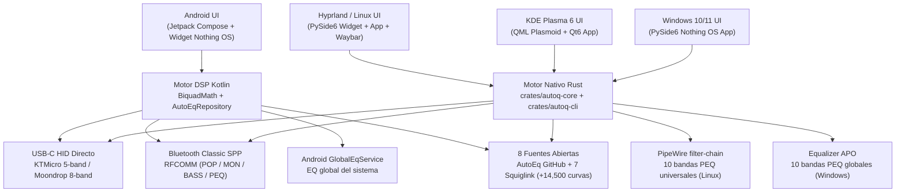

# Arquitectura técnica de AutoQ

AutoQ comparte el mismo modelo conceptual, matemáticas de filtros RBJ y protocolos de comunicación binaria entre su **motor nativo multiplataforma en Rust (`autoq-core` / `autoq-cli`)** para escritorio (Linux y Windows) y su **motor nativo Kotlin** en Android.

---

## 1. Motor Nativo en Rust (`crates/autoq-core` + `crates/autoq-cli`)
- **Ejecutable único ultraligero (`~2.9 MB`)** sin dependencias externas de Python (`numpy`, `requests`) ni OpenSSL del sistema (usa `rustls`).
- **Latencia sub-milisegundo**:
  - `autoq-cli poll`: huella instantánea (`~1 ms`) de presencia USB HID y enlaces Bluetooth en `/sys/class`, reemplazando a `moondrop_poll.c` en KDE Plasma 6.
  - `autoq-cli waybar-status`: telemetría directa en JSON para Waybar sin levantar Python ni Qt.
- **Compatibilidad contractual 100 %**: implementa todos los subcomandos JSON (`status`, `apply`, `flat`, `search`, `source-fr`, `autoeq-match`, `autoeq-target`, `preset-save`, `preset-delete`, `import-apo`, `export-apo`, `bt-spp`) en Linux y Windows.

## 2. Motor Matemático DSP (`biquad.rs` / `BiquadMath.kt`)
- Calcula la respuesta en magnitud (dB) sobre una rejilla logarítmica estándar de **128 puntos entre 20 Hz y 20,000 Hz** (`standard_grid`).
- Implementa filtros **Audio EQ Cookbook (RBJ)**:
  - `peaking` (`PK`)
  - `low_shelf` (`LS` / `LSC`)
  - `high_shelf` (`HS` / `HSC`)
- Ajusta curvas objetivo mediante búsqueda greedy de residuales + descenso coordinado conjunto (RMSE ponderado perceptual) en **`< 0.5 ms` en Rust** respetando las restricciones de cada hardware:
  - **5 bandas** para chips KTMicro (Chu 2 DSP, CDSP, Quark 2, Jiu, May).
  - **8 bandas** para dispositivos Moondrop 8-band (FreeDSP Pro/Mini, Rays, AG Rays, Marigold, DAWN PRO 2, Echo A, MOONRIVER 3, DHA15).
  - **10 bandas** para salidas virtuales en PipeWire, Equalizer APO y Android Global EQ.

## 3. Motor AutoEQ Multi-fuente (`autoeq.rs` / `AutoEqRepository.kt`)
- Descarga en paralelo los índices de **8 repositorios abiertos**:
  1. `jaakkopasanen/AutoEq` (GitHub)
  2. `Super* Review` (`squig.link/data/`)
  3. `ReganCipher` (`regancipher.squig.link/data/`)
  4. `Aftersound` (`aftersound.squig.link/data/`)
  5. `HBB` (`hbb.squig.link/data/`)
  6. `Paul Wasabii` (`pw.squig.link/data/`)
  7. `Jaytiss` (`jaytiss.squig.link/data/`)
  8. `GadgetryTech` (`gadgetrytech.squig.link/headsets/data/`)
- Normaliza nombres y puntuación (`Zero:3` → `zero 3`) para búsqueda en `< 18 ms` sobre +14,500 curvas.
- Cachea índices y perfiles localmente (`~/.cache/autoq` con lectura retrocompatible de `~/.cache/chu2-dsp-widget`).

## 4. Capas de salida
1. **Hardware USB-C HID (`hid.rs`)**: acceso directo por `/dev/hidraw` en Linux (cero librerías C externas) y `hidapi` nativo en Windows para protocolos KTMicro (5B) y Moondrop (8B, biquads en punto fijo Q2.30 a 96 kHz), con verificación de registros antes de hacer `COMMIT` en memoria flash.
2. **PipeWire `filter-chain` (`platform_linux.rs`)**: cadena nativa de 10 bandas en PipeWire para cualquier salida Bluetooth, DAC USB o 3.5 mm en Linux.
3. **Equalizer APO (`platform_windows.rs`)**: generación de `autoq_eq.txt` con preamp automático anti-clipping en Windows 10/11.
4. **Android `GlobalEqService`**: ecualización paramétrica global a nivel de sistema en Android.
5. **Bluetooth Classic SPP**: sockets RFCOMM nativos (`AF_BLUETOOTH` en Linux / `BluetoothSocket` en Android) para modos y PEQ en modelos Moondrop compatibles.
