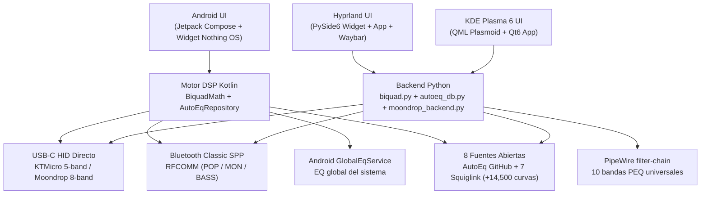

# Arquitectura técnica de AutoQ

AutoQ comparte el mismo modelo conceptual, matemáticas de filtros y protocolos de comunicación entre **Android (Kotlin)** y **Linux (Python / Qt6 / QML)**.

---

## 1. Motor Matemático DSP (`biquad.py` / `BiquadMath.kt`)
- Calcula la respuesta en magnitud (dB) sobre una rejilla logarítmica estándar de **128 puntos entre 20 Hz y 20,000 Hz** (`STANDARD_GRID`).
- Implementa filtros **Audio EQ Cookbook (RBJ)**:
  - `peaking` (`PK`)
  - `low_shelf` (`LS` / `LSC`)
  - `high_shelf` (`HS` / `HSC`)
- Ajusta curvas objetivo mediante optimización ponderada (RMSE ponderado por banda perceptual) respetando el número máximo de bandas del destino:
  - **5 bandas** para chips KTMicro (Chu 2 DSP, CDSP, Quark 2).
  - **8 bandas** para dispositivos Moondrop 8-band (FreeDSP Pro/Mini, Rays, Dawn Pro 2, etc.).
  - **10 bandas** para salidas virtuales en PipeWire / Android Global EQ.

## 2. Motor AutoEQ Multi-fuente (`autoeq_db.py` / `AutoEqRepository.kt`)
- Descarga en paralelo los índices de **8 repositorios abiertos**:
  1. `jaakkopasanen/AutoEq` (GitHub)
  2. `Super* Review` (`squig.link/data/`)
  3. `ReganCipher` (`regancipher.squig.link/data/`)
  4. `Aftersound` (`aftersound.squig.link/data/`)
  5. `HBB` (`hbb.squig.link/data/`)
  6. `Paul Wasabii` (`pw.squig.link/data/`)
  7. `Jaytiss` (`jaytiss.squig.link/data/`)
  8. `GadgetryTech` (`gadgetrytech.squig.link/headsets/data/`)
- Normaliza nombres y puntuación (`Zero:3` → `zero 3`) para búsqueda tolerante entre distintos acopladores (711, B&K 5128, over-ear).
- Cachea índices y curvas localmente para minimizar latencia y permitir uso offline tras la primera sincronización.
- Permite dos modos de calibración:
  - **Hacia curva target**: iguala el audífono seleccionado a cualquiera de las 8 curvas curadas (*AutoEq In-Ear*, *Harman In-Ear 2019*, *Harman Over-Ear 2018*, *JM-1 con filtros Harman*, *Diffuse Field 5128*, *Oratory1990*).
  - **Imitar otro audífono**: calcula la diferencia relativa normalizada entre la curva del audífono fuente y el audífono objetivo y sintetiza las bandas PEQ equivalentes.

## 3. Capas de salida
1. **Hardware USB-C HID**: escribe directamente en RAM (`LIVE`) o persiste en memoria flash (`COMMIT`) del chip DSP integrado en el cable/DAC.
2. **PipeWire `filter-chain` (Linux)**: genera una cadena nativa de filtros biquad en PipeWire de 10 bandas con preamp automático para evitar *clipping* digital en cualquier dispositivo Bluetooth, USB o 3.5 mm.
3. **Android `GlobalEqService`**: aplica ecualización paramétrica en tiempo real a nivel de sistema cuando el dispositivo conectado no posee chip HID compatible.
4. **Bluetooth Classic SPP**: comunicación opcional RFCOMM para cambiar/leer modos integrados (`POP`, `MON`, `BASS`) en modelos Moondrop TWS compatibles.
