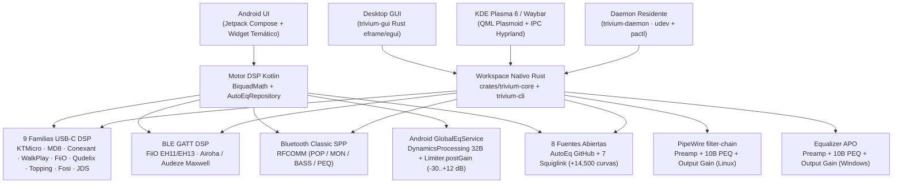

# Arquitectura técnica de Trivium

Trivium comparte el mismo modelo conceptual, matemáticas de filtros RBJ y protocolos binarios entre su **workspace nativo en Rust** para escritorio (`trivium-core`, `trivium-gui`, `trivium-cli`, `trivium-daemon` en Linux, Windows y macOS ARM64) y su **motor nativo Kotlin** en Android.

---

## 1. Workspace Nativo en Rust (`crates/*`)
- **`crates/trivium-core`**: optimizador RBJ/PEQ, cálculo de headroom/preamp anti-clipping + ganancia/atenuación de salida (`-30.0..+12.0 dB`), cliente concurrente de 8 bases AutoEQ + Squiglink, exportadores (`EqualizerAPO`, `EasyEffects JSON`, `CamillaDSP YAML`, `Wavelet GraphicEQ`), códecs BLE GATT (`ble_dsp.rs`), backends `PipeWire` y `Equalizer APO`, acceso serial/USB HID y cápsula POSIX RAII segura (`posix_fd.rs` basada en `OwnedFd`).
- **`crates/trivium-gui`**: interfaz nativa multiplataforma en `eframe`/`egui` con temas modulares (**`Default`**, **`Default claro`**, **`NothingOS`**), 8 colores de resaltado, comparación instantánea **A / B**, gráfica interactiva, instaladores 1-clic y socket Unix IPC (`--toggle`, `--widget`).
- **`crates/trivium-cli`**: binario JSON/CLI ultraligero con subcomandos de telemetría sub-milisegundo (`poll`, `waybar-status`), diagnóstico HID (`hid-scan --dump-descriptors`), catálogo BLE (`ble-protocols`), `--output-gain` y exportación multi-formato (`eq --format`, `export-format`).
- **`crates/trivium-daemon`**: demonio residente opcional que escucha eventos `udevadm monitor` + `pactl subscribe` en Linux (y sondeo en Windows vía Registro nativo sin abrir ventanas de consola) para aplicar perfiles guardados automáticamente.

## 2. Motor Matemático DSP (`biquad.rs` / `BiquadMath.kt`)
- Calcula la respuesta en magnitud (dB) sobre rejillas logarítmicas entre **20 Hz y 20,000 Hz** (`standard_grid` y rejilla de 256 puntos para `peak_boost_db` / `headroom_margin_db`).
- Implementa filtros **Audio EQ Cookbook (RBJ)**: `Peaking` (`PK`), `LowShelf` (`LS` / `LSC`) y `HighShelf` (`HS` / `HSC`).
- Protege contra valores no finitos (`NaN` / `±∞`) antes de cuantizar a la resolución de cada protocolo hardware.
- Ajusta curvas objetivo mediante búsqueda greedy de residuales + descenso coordinado conjunto en **`< 0.5 ms` en Rust**.

## 3. Motor AutoEQ Multi-fuente y Exportadores (`autoeq.rs` / `AutoEqRepository.kt`)
- Descarga en paralelo los índices de **8 repositorios abiertos**:
  1. `jaakkopasanen/AutoEq` (GitHub)
  2. `Super* Review` (`squig.link/data/`)
  3. `ReganCipher` (`regancipher.squig.link/data/`)
  4. `Aftersound` (`aftersound.squig.link/data/`)
  5. `HBB` (`hbb.squig.link/data/`)
  6. `Paul Wasabii` (`pw.squig.link/data/`)
  7. `Jaytiss` (`jaytiss.squig.link/data/`)
  8. `GadgetryTech` (`gadgetrytech.squig.link/headsets/data/`)
- Normaliza nombres y puntuación (`Zero:3` → `zero 3`) con caché local (`~/.cache/trivium`, migrada automáticamente desde `~/.cache/autoq`).
- Exporta directamente a **EqualizerAPO** (`ParametricEQ.txt`), **EasyEffects** (`v7 IIR JSON`), **CamillaDSP** (`v2 YAML`) y **Wavelet** (`GraphicEQ:` de 127 bandas normalizado a ≤ 0 dB).

## 4. Capas de salida
1. **Hardware USB-C HID / Serial (`hid.rs`, `jds_serial.rs`)**: `/dev/hidraw*` y `/dev/ttyACM*` vía descriptores RAII `OwnedFd` en Linux; `hidapi` (`windows-native` en Windows, `macos-shared-device` en macOS ARM64) + `winreg` (cero subprocesses) en Windows; `UsbManager` en Android. Cubre **KTMicro**, **Moondrop 8B**, **Conexant Freeman 9B**, **WalkPlay**, **FiiO**, **Qudelix-5K**, **Topping**, **Fosi DS3** y **JDS Labs Element IV**.
2. **BLE GATT DSP (`ble_dsp.rs` / `BleDspTransport.kt`)**: códecs binarios verificados y transporte `BluetoothGatt` nativo en Android para **FiiO EH11/EH13** y **Airoha / Audeze Maxwell**.
3. **PipeWire `filter-chain` (`platform_linux.rs`)**: nodo previo `mixer` de preamp anti-clipping + cadena de 10 bandas `bq_*` + nodo final `eq_output_gain` (`-30.0..+12.0 dB`) en Linux.
4. **Equalizer APO (`platform_windows.rs`)**: generación de `trivium_eq.txt` con preamp anti-clipping, filtros paramétricos y ganancia/atenuación de salida (`-30.0..+12.0 dB`) en Windows 10/11.
5. **Android `GlobalEqService`**: ecualización paramétrica global a nivel de sistema (`DynamicsProcessing` 32B) con compensación de preamp y etapa de ganancia/atenuación de salida (`Limiter.postGain` de `-30.0` a `+12.0 dB`) por app o sesión 0.
6. **Bluetooth Classic SPP**: sockets RFCOMM nativos en Linux y `BluetoothSocket` en Android.
